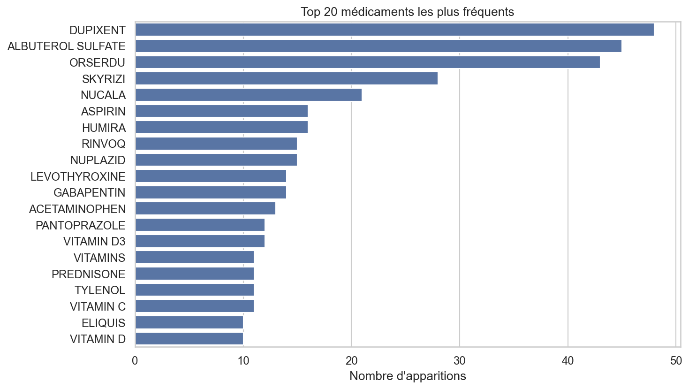
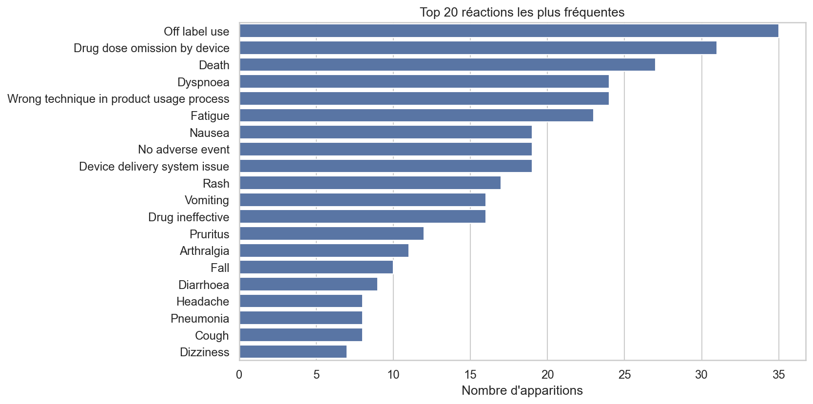
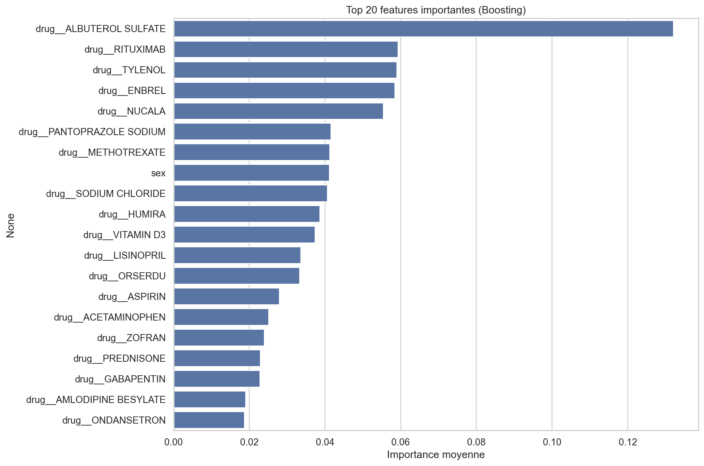

# Drug Side-Effect Prediction (FAERS + SIDER)

A multi-label machine learning project that predicts likely adverse drug reactions from a patient's medications, age and sex. It combines real-world reports from FAERS with the SIDER knowledge base, explains its predictions with SHAP and exposes the model through a Streamlit interface. It was developed as an academic data mining project at the National Engineering School of Tunis (ENIT).

> This is an academic project. It is not a medical tool and must not be used for clinical decisions.

## Approach

1. **Parsing FAERS reports:** drugs, reactions, age (normalized by unit), sex, seriousness and country are extracted from the XML files.
2. **Hybrid dataset:** FAERS reports are merged with the known drug and side-effect associations from SIDER.
3. **Feature engineering:** one-hot encoded drugs, age, sex, number of drugs and knowledge features derived from SIDER.
4. **Exploratory analysis:** most frequent drugs and reactions, age and sex distributions, drug co-occurrences, comparison between SIDER and FAERS.
5. **Models:** Random Forest, XGBoost and Logistic Regression in a One-vs-Rest setting, with class weighting and resampling to handle label imbalance.
6. **Blending:** the probabilities of the base models feed an XGBoost meta-model, with one decision threshold per side effect and a guaranteed minimum number of predictions.
7. **Explainability:** SHAP values show which features drive each prediction.
8. **RAG experiment:** a retrieval-augmented generation prototype (DPR, FAISS) to query the same data in natural language.

## Figures

| Most reported drugs | Most reported reactions | Feature importance |
|---|---|---|
|  |  |  |

## Repository structure

| File | Role |
|---|---|
| `hybrid_pipeline.py` | Full pipeline: parsing, hybrid dataset, exploratory analysis, model training and SHAP analysis |
| `train_blending_model.py` | Final model: blending of the base models with per-label thresholds |
| `app.py` | Streamlit interface: enter medications, age and sex, get the predicted side effects |
| `rag_experiment.py` | Retrieval-augmented generation prototype |
| `data/` | FAERS extract (2025 Q2) and SIDER associations used by the scripts |
| `figures/` | Exploratory analysis and feature importance plots |

## Getting started

```bash
git clone https://github.com/rihem-khouildi/drug-side-effects-prediction.git
cd drug-side-effects-prediction
pip install -r requirements.txt

python hybrid_pipeline.py          # exploratory analysis, training and SHAP
python train_blending_model.py     # trains and saves the blending model
streamlit run app.py               # launches the interface
```

The RAG prototype needs additional dependencies:

```bash
pip install -r requirements-rag.txt
python rag_experiment.py
```

## Data sources

- **FAERS:** FDA Adverse Event Reporting System, quarterly data files.
- **SIDER:** Side Effect Resource, a database of marketed drugs and their recorded adverse reactions.

## Limitations

- **Small dataset:** after filtering, only a few hundred samples remain for several dozen labels.
- **Reporting bias:** FAERS contains spontaneous reports, which show associations and not causality.
- **Generalization:** in our experiments, scores measured on internal splits were much higher than on external validation data, which indicates overfitting. The final version splits the data before augmentation to limit leakage.
- **Next steps:** train on more reports, validate by drug rather than by report, and calibrate the probabilities.

